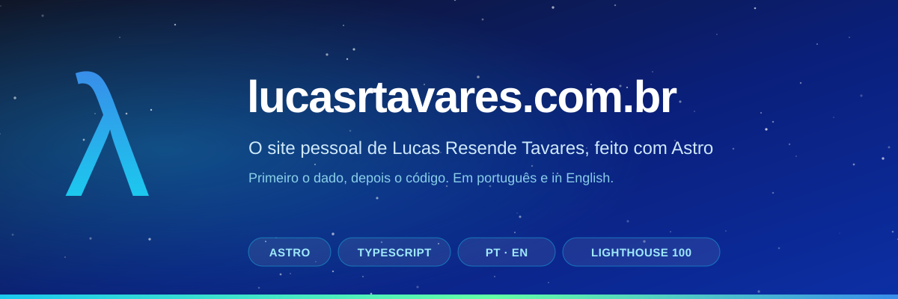
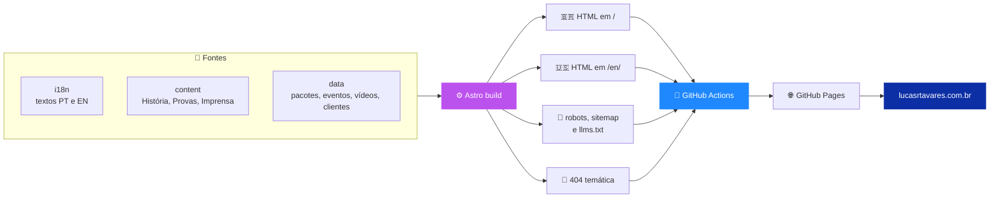
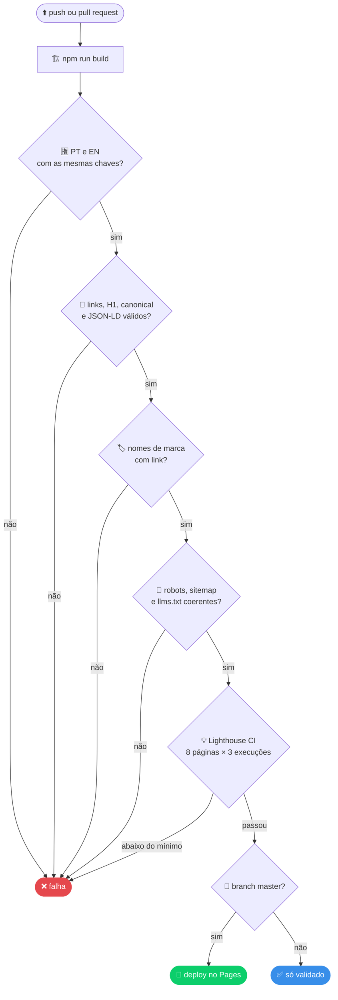
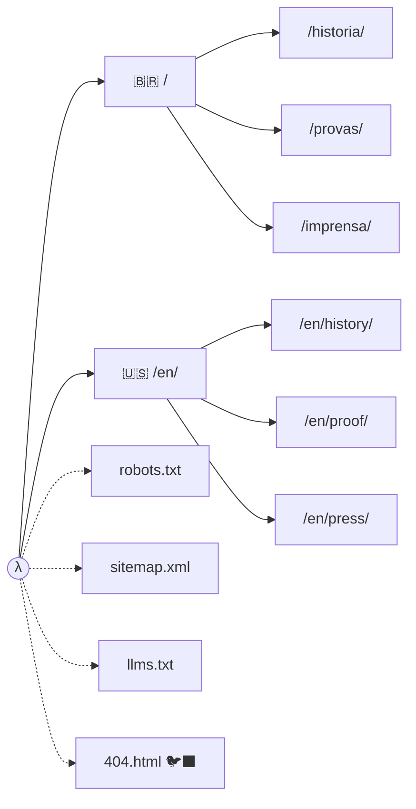
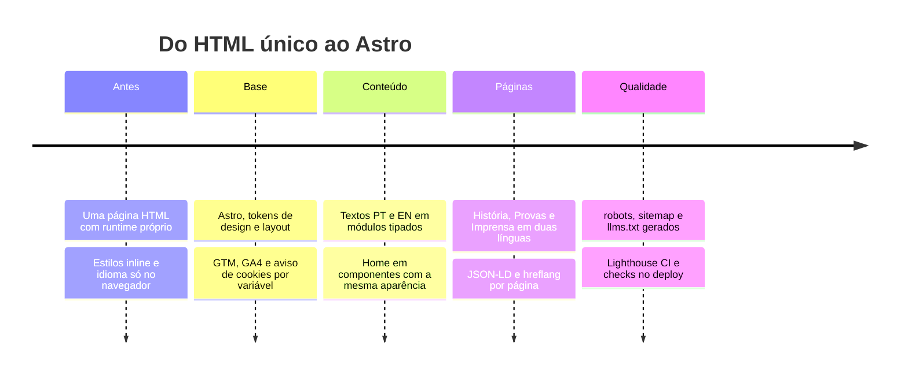

<div align="center">



<br>

### 🌐 O código por trás de [lucasrtavares.com.br](https://lucasrtavares.com.br)
**Um site de conteúdo que se comporta como um site de conteúdo: HTML pronto no build, duas línguas, zero peso à toa.**

*Primeiro o dado, depois o código.*

<br>

[](https://lucasrtavares.com.br)
[](https://astro.build)
[](https://www.typescriptlang.org)
[](https://nodejs.org)
[](.github/workflows/deploy.yml)
[](https://pages.github.com)


🇧🇷 Português logo abaixo · 🇺🇸 [English summary](#-english)

</div>

---

## 🐦‍⬛ O que é isso?

O site pessoal de **Lucas Resende Tavares**, Sales Engineer e Arquiteto de Soluções na [RavenDB](https://ravendb.net). Ele conta a história, mostra as provas (casos, código e palestras) e leva o visitante a uma conversa por WhatsApp ou e-mail. Sem formulário, sem backend, sem banco de dados no meio do caminho. 😄

> [!NOTE]
> Este site é pessoal e **não** é um canal oficial da RavenDB.

| | |
|---|---|
| 🗣️ **Duas línguas, duas URLs** | Português em `/` e inglês em `/en/`, cada um com `canonical` e `hreflang` próprios |
| 🧱 **HTML pronto no build** | Nada de texto que só aparece depois do JavaScript: o que o Google e as IAs leem é o que você vê |
| 🤖 **Feito para ser lido por IA** | `llms.txt` e `sitemap.xml` gerados a partir dos mesmos dados das páginas, então não divergem |
| ⚡ **Leve** | JavaScript só onde precisa (idioma, vídeo, filtro, progresso de leitura) e fotos em WebP |
| 🧪 **Testado a cada mudança** | Idiomas, links, JSON-LD, SEO e Lighthouse rodam no CI antes de qualquer deploy |

---

## 🧰 Stack

<div align="center">


</div>

**Por que Astro e não React?** É um site de conteúdo (4 páginas × 2 idiomas), não uma aplicação. O ganho está em renderizar no build, não em reatividade no navegador. Se o framework sumir um dia, o HTML continua funcionando. 🪶

---

## 🗺️ Como tudo se encaixa



### 🚦 O que acontece a cada push



### 📍 O mapa do site



### 🧬 Como o site evoluiu



---

## ▶️ Rodando localmente

Requer **Node 22.23+** (testado no 24) e **npm**.

```bash
npm install
npm run dev        # http://localhost:4321/
```

| Comando | O que faz |
|---|---|
| `npm run dev` | servidor de desenvolvimento com recarga ao vivo |
| `npm run build` | gera o site estático em `dist/` |
| `npm run preview` | serve o build como ele vai para produção |
| `npm run verify` | build **+** todos os checks (abaixo) |

---

## 🗂️ Estrutura

```text
src/
├─ config.ts            variáveis PUBLIC_* e links de WhatsApp
├─ i18n/                textos da home e do layout, PT e EN (en é tipado como pt)
├─ content/             páginas História, Provas e Imprensa, PT e EN
├─ data/                pacotes NuGet, eventos, vídeos, artigos, clientes, depoimentos, JSON-LD
├─ components/          Hero, LeadCards, Timeline, OpenSource, Videos, PageHero, CtaCards…
├─ layouts/Base.astro   <head>, cabeçalho, rodapé e aviso de cookies
├─ pages/               rotas + robots.txt, sitemap.xml, llms.txt e 404
├─ scripts/             módulos pequenos de JavaScript
└─ styles/              tokens e estilos globais
public/                 imagens, CNAME, .nojekyll
design/                 fontes de arte (cosmic-bg.svg, capa deste README)
scripts/                verificações do build
```

---

## 🔐 Variáveis de ambiente

São **públicas** (vão para o HTML), então não há segredo aqui. Copie `.env.example` para `.env`; no GitHub, use *Settings → Secrets and variables → Actions → Variables*.

| Variável | Para quê |
|---|---|
| `PUBLIC_SITE_URL` | domínio (canonical, sitemap, Open Graph) |
| `PUBLIC_GTM_ID` · `PUBLIC_GA_ID` | Tag Manager e GA4 (só carregam no build de produção) |
| `PUBLIC_WHATSAPP_RAVENDB` · `PUBLIC_WHATSAPP_LEADSOFT` | números dos botões de WhatsApp |
| `PUBLIC_EMAIL_RAVENDB` · `PUBLIC_EMAIL_PERSONAL` | e-mails de contato |
| `PUBLIC_SHOW_FULL_STORY` | capítulo completo da página História (padrão: ligado; `false` oculta) |

---

## ✅ Verificações

`npm run verify` é o botão do "está tudo certo?":

| Check | O que confere |
|---|---|
| 🈯 `check:i18n` | PT e EN com as mesmas chaves, sem texto vazio e listas do tamanho dos dados |
| 🔗 `check:links` | links e recursos internos existem, 1 H1, `lang`, `canonical`, JSON-LD válido, imagens com `alt` |
| 🏷️ `check:brand` | todo "LeadSoft" no texto leva ao site da empresa |
| 🔎 `check:seo` | `robots.txt`, `sitemap.xml` (8 URLs com hreflang) e `llms.txt` batem com as páginas geradas |
| 💡 Lighthouse CI | as 8 páginas, 3 execuções cada, mínimo de **0,98** em acessibilidade, boas práticas e SEO, e **0,90** em desempenho no runner do GitHub (localmente dá 100) |

---

## 🎨 Detalhes de que eu gosto

- 🐦‍⬛ **A página 404 fala RQL**: mostra uma consulta `from Pages where Path = '/o-que-voce-digitou'` com *0 resultados*, sugere a página mais parecida e conclui que *até o olho do corvo falha quando a consulta aponta pro lugar errado*.
- 🌍 **O cartão "Base" tem um mapa-múndi de pontos** com Curitiba pulsando e rotas animadas para as Américas, a Europa e a Oceania. Gerado de dados geográficos abertos e salvo como um SVG de 18 KB.
- 🇧🇷🇺🇸 **O cartão "Idiomas" mistura as duas bandeiras**, desenhadas à mão em SVG.
- 📈 **Barra de progresso de leitura** no cabeçalho, em CSS e 20 linhas de script.
- 🎵 **Player do Spotify só carrega no clique** (nada de requisição de terceiros antes disso).
- 🍪 **Aviso de cookies (LGPD)** que respeita o idioma da página.
- 🧭 **Redirecionamento de idioma por preferência**, só no navegador, para nunca atrapalhar um rastreador.

---

## 🚀 Deploy

`.github/workflows/deploy.yml` constrói, verifica e roda o Lighthouse CI. Em **push na `master`**, publica no GitHub Pages; em qualquer outra branch ou pull request, só valida.

---

## 📬 Contato

| | |
|---|---|
| 🌐 **Site** | [lucasrtavares.com.br](https://lucasrtavares.com.br) |
| 💼 **LinkedIn** | [in/lucasrtavares](https://www.linkedin.com/in/lucasrtavares/) |
| 🎬 **YouTube** | [@LucasResendeTavares](https://www.youtube.com/@LucasResendeTavares) |
| 📦 **NuGet** | [lucastavares](https://www.nuget.org/profiles/lucastavares) |
| ✉️ **E-mail** | [lucas.tavares@ravendb.net](mailto:lucas.tavares@ravendb.net) · [eu@lucasrtavares.com.br](mailto:eu@lucasrtavares.com.br) |

<sub>Licença **MIT**. Ver [LICENSE](LICENSE).</sub>

---

<a id="-english"></a>

<details>
<summary><h2>🇺🇸 English</h2></summary>

<br>

The source code of **[lucasrtavares.com.br](https://lucasrtavares.com.br)**, the personal site of **Lucas Resende Tavares**, Sales Engineer and Solutions Architect at [RavenDB](https://ravendb.net). It is a personal site, **not** an official RavenDB channel.

- 🗣️ **Two languages, two URLs:** Portuguese at `/`, English at `/en/`, each with its own `canonical` and `hreflang`.
- 🧱 **Pre-rendered HTML** built with **Astro** and **TypeScript**: what crawlers and AI assistants read is what you see.
- 🤖 **AI-readable:** `llms.txt`, `sitemap.xml` and JSON-LD are generated from the same data as the pages.
- 🧪 **Tested on every push** with GitHub Actions: i18n parity, links, SEO and **Lighthouse CI** (100 / 100 / 100 / 100 on all 8 pages, locally) before anything is deployed to GitHub Pages.
- 🐦‍⬛ **A database-themed 404:** it "runs" an RQL query, finds nothing and suggests the closest page.

```bash
npm install
npm run dev       # http://localhost:4321/
npm run verify    # build + all checks
```

</details>
